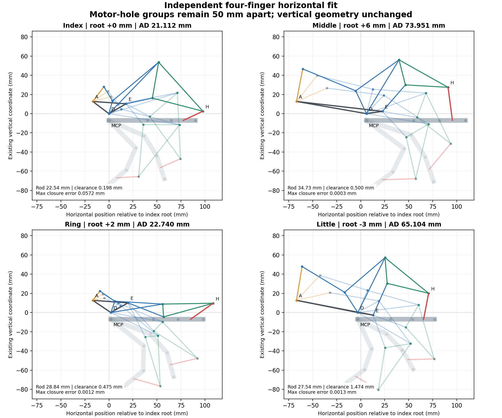
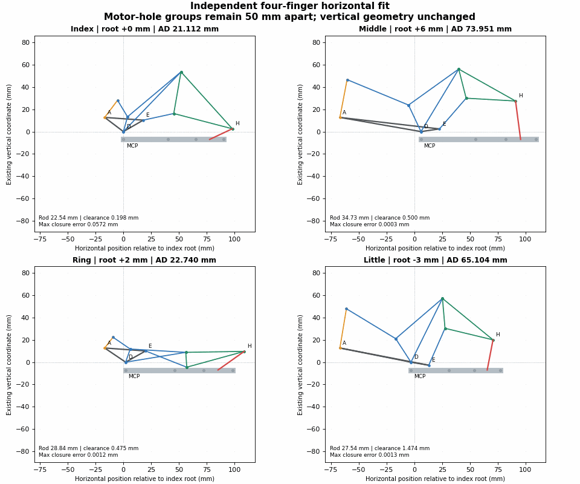

# 四指独立水平安装优化（2026-11-17）

以食指 MCP 指根为水平基准，向指尖方向为正。指节长度沿用既有测量：食指 40/25/25、中指 49/27/27、无名指 44/26/26、小指 34/23/23 mm。拇指不参与这次更新。

固定电机安装孔仍分为相差 50 mm 的两组；仅按新指根位置重新计算每指水平安装几何。原 A–D 垂直分量 12.721404 mm、D–MCP 的 7 mm 间隙及全部指节宽度保持原值，没有进行垂直方向优化。

| 手指 | 指根相对食指 | 电机孔向后偏移 | 相对食指的水平跨度增量 | A–D 水平分量 | AD 直线长度 |
|---|---:|---:|---:|---:|---:|
| 食指 | 0 | 0 | 0 | 16.848811 | 21.112000 |
| 中指 | +6 | 50 | 56 | 72.848811 | 73.951223 |
| 无名指 | +2 | 0 | 2 | 18.848811 | 22.740092 |
| 小指 | −3 | 50 | 47 | 63.848811 | 65.103800 |

单位均为 mm。共同掌部坐标中，食指/无名指的电机 A_x 都为 −16.848811；中指/小指都为 −66.848811。因此没有把已有孔位改成 56 mm。

## 本轮结果

| 手指 | 采用结果 | 输出杆 H–R4 (mm) | 输入安装相位 (°) | 1201 姿态最小间隙 (mm) | 最大闭环误差 (mm) |
|---|---|---:|---:|---:|---:|
| 食指 | 重跑后保留原候选 | 22.539000 | 0 | 0.197549 | 0.057245 |
| 中指 | 新优化候选 | 34.727957 | +0.906461 | 0.499748 | 0.000250 |
| 无名指 | 新优化候选 | 28.840839 | +3.787730 | 0.475040 | 0.001160 |
| 小指 | 新优化候选 | 27.541093 | −1.830727 | 1.474236 | 0.001259 |

完整杆长、求解日志与检查数据在各指子目录；汇总为 `summary.json`。旧候选均保留。





每指的独立可复用配置在 `src/co-optimization/config/index/`、`middle/`、`ring/`、`little/`；独立装配 YAML 在 `designs/mechanism_2/per_finger/<finger>/mechanism.yaml`。新配置一次只含该指的目标和安装几何，旧 `long_ad`/`short_ad` 入口保持兼容。

`input_phase_deg` 是相对旧数学模型的输入安装相位，不是实物舵机零位。优化器现在读取它、保持输入 q 的相对坐标，并连续追踪原装配分支；输出 YAML 的初始节点也包含这个相位。迁移实物仍需标定。

## 求解与复现

本轮用 SciPy 最小二乘直接配点求解，先 7 点、后 17 点；各指长度和起始角独立。残差包括闭环、采样人体间隙、弱输出杆缩短和原长度正则；**输出杆垂直度仅报告，未作为本轮的最小二乘目标**。这属于满足新安装条件的局部可行候选，不声称全局最优。

保留通过现有曲柄驱动、被动单自由度手指闭环检查的候选，按输出杆长度选取；随后用 1801 点曲柄搜索、1201 姿态检查每指闭环、间隙与单调下弯。默认闭环容差 0.1 mm。重新读取各指配置后又通过相同密度的检查。食指新解没有优于旧候选，所以保留原参数。

依赖：NumPy、SciPy、PyYAML；画图另需 Matplotlib、Pillow。此次没有运行 PyTorch Adam；当前本机没有 PyTorch，原有两项调用 Adam 的集成测试无法执行。

```bash
# 从仓库根目录重新生成；结果另存，避免覆盖采用的候选
for finger in index middle ring little; do
  python3 docs/candidates/four_finger_offsets_2026_11_17/optimize_fingers.py \
    --repo . --finger "$finger" --out "runs/horizontal_offsets/$finger"
done

# 验证加载后的安装几何、正负相位与全部四指的 1201 姿态
python3 -m unittest discover -s tests -p 'test_finger_mounts.py'

# 安装原优化环境后，也可用标准 Adam 入口单独继续改进某一指
./run_optimization.sh --design middle --finger middle
```

本轮修改前的源提交为 `c7da626`，算法代码与采用的输入/输出均留在库中。模型是二维运动学与简化人体间隙筛选；没有更新 Onshape、STEP、MuJoCo 实物标定或五指 CAD 总装。输出杆垂直度、三维相邻手指碰撞、制造间隙和驱动力还需后续验证。
