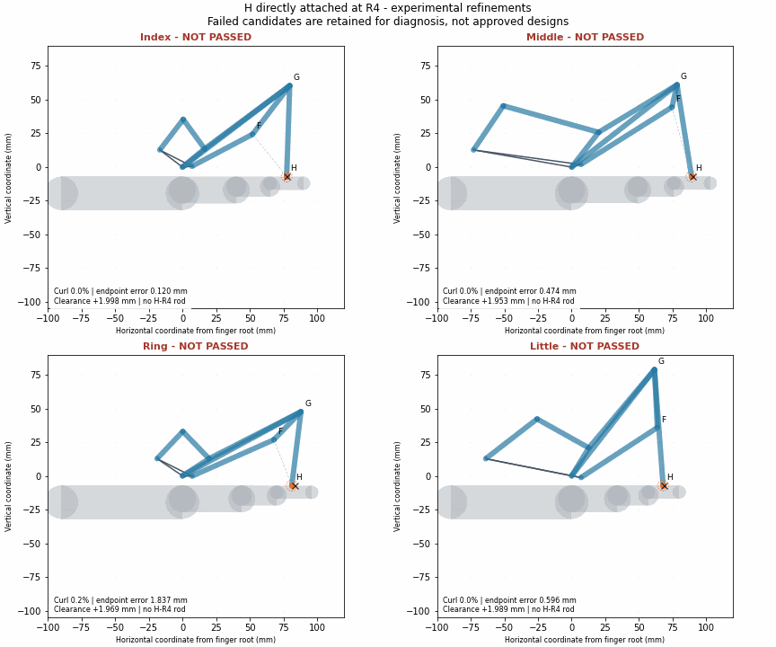

# H 与 R4 直接连接：验证报告

日期：2026-11-18。此报告是独立的数值验证，不是制造定稿。

## 结论

取消 H–R4 杆在运动学上成立：将新 GH、FH 设为旧 G–R4、F–R4，原刚性输出的 R4 轨迹得到保留。但是直接改成两臂 FG/GH 的输出件会改变实体外形，原先的避碰结论不能沿用。
本轮在保留安装孔、根部偏移、手指尺寸及原有比例屈曲轨迹的条件下，进行了两种外形、每指两级局部优化；结果如下。尚未证明全局不可行。

## 直接转换后的两臂折杆

| 手指 | 最大轨迹误差 mm | 最小间隙 mm | 最危险部位 |
|---|---:|---:|---|
| 食指 | 0.1432 | -0.1806 | L_gh/distal |
| 中指 | 0.0946 | -0.5845 | L_gh/distal |
| 无名指 | 0.0928 | -4.0160 | L_gh/middle |
| 小指 | 0.1965 | -0.6354 | L_gh/middle |

负间隙表示模型中的重叠，不能直接当作真实零件的穿透深度。四指最危险位置均接近最大弯曲。

## 调整尺寸后的候选

| 手指 | 最大轨迹误差 mm | 最小间隙 mm | 判定 |
|---|---:|---:|---|
| 食指 | 0.1205 | 0.0908 | 未通过 |
| 中指 | 0.5129 | -0.2072 | 未通过 |
| 无名指 | 1.8628 | -0.0804 | 未通过 |
| 小指 | 0.5970 | 0.0029 | 未通过 |

判据：每指独立采样 1,201 个输入位置；全行程 H 对手指 R4 轨迹的误差 ≤ 0.1 mm，非允许接触处间隙 ≥ 0，并满足装配、行程覆盖及单调屈曲检查。局部优化使用 17、33 个姿态，密集验证独立进行；中间迭代也重新验证。
不能将优化器返回 success 等同于机构通过验证，也不能将存在小的拟合误差表述为代数上严格闭合。

## 外形与接触的处理

- 新模型没有 `L_tip_rod`，也没有垂直约束；H 是末端唯一的转动连接点。
- 原库将输出件绘制为 FG/GH 两臂折杆，但旧避碰计算使用实心 FGH 三角形。本报告两者都验证，主要图和候选采用折杆。FH 仍然定义刚体形状，不代表必须有一根实体 FH 杆。
- 两臂按 2 mm 半径处理。原 R4 处 4 mm 安装接触豁免移到 H，仅裁去连接端附近的局部区域；D 处保留原 12 mm 安装豁免。没有忽略整个末节手指或整个输出件。
- 中央 CDG 部件仍采用原保守实体几何。没有重新确认实际 CAD 厚度、轴向错层或连接件外形。

## 下一步建议

优先保持 H=R4，研究 GH 整体输出件的避让外形，而非继续增加连接杆。端点直接连接不要求端点之间的材料必须是直线；一体式弯曲件可能绕开手指，但其刚度、厚度和三维装配尚需验证。
如果要求 GH 保持直线，则还需要继续联合优化 F/G 位置和其他杆长；本轮局部搜索尚不足以保证成功。原手指轨迹将三个关节规定为同一进度按比例弯曲，并非实测完整轨迹，也可能是限制因素。改变这条路径或 R4 的安装位置会改变验证前提，需要在后续结果中明确说明。

## 验证范围与复现

三项数值测试检查线段距离、全行程转换等价性和局部接触豁免。验证仅为平面采样结果；未认证连续区间、三维/邻指碰撞、全局最优性、力传递、刚度或完整奇异性。较小正间隙也不代表制造余量充分。
源仓库提交：`5c6de0cd9462f1d3ca2746d4f3594eba5d33924c`。程序自动定位所属仓库，也可用 `KINEMATIC_CHAIN_REPO` 指向另一个检出位置；四指输入固定在 `input_snapshot/`，不会读取之后修改的正式尺寸配置。

在本候选目录内执行（需要 NumPy、SciPy、PyYAML；绘图还需要 Matplotlib 和 Pillow）：

```bash
python3 -B test_direct.py
python3 -B direct.py validate --source selected/index/result.json --out /tmp/h-direct-check
```

数据：`summary.json`、`dimension_changes.csv`、`selected/`；原始直接转换：`direct_conversion/`；两种外形的所有局部优化结果保存在 `searches/` 和相应的 `refined_*` 目录。动画：`motion.gif`。

重新生成报告和图像（写入指定的新目录）：

```bash
python3 -B package.py --out /tmp/h-direct-report
# 仅复核数据及静态图，跳过动画：
python3 -B package.py --out /tmp/h-direct-report-fast --skip-gif
```


