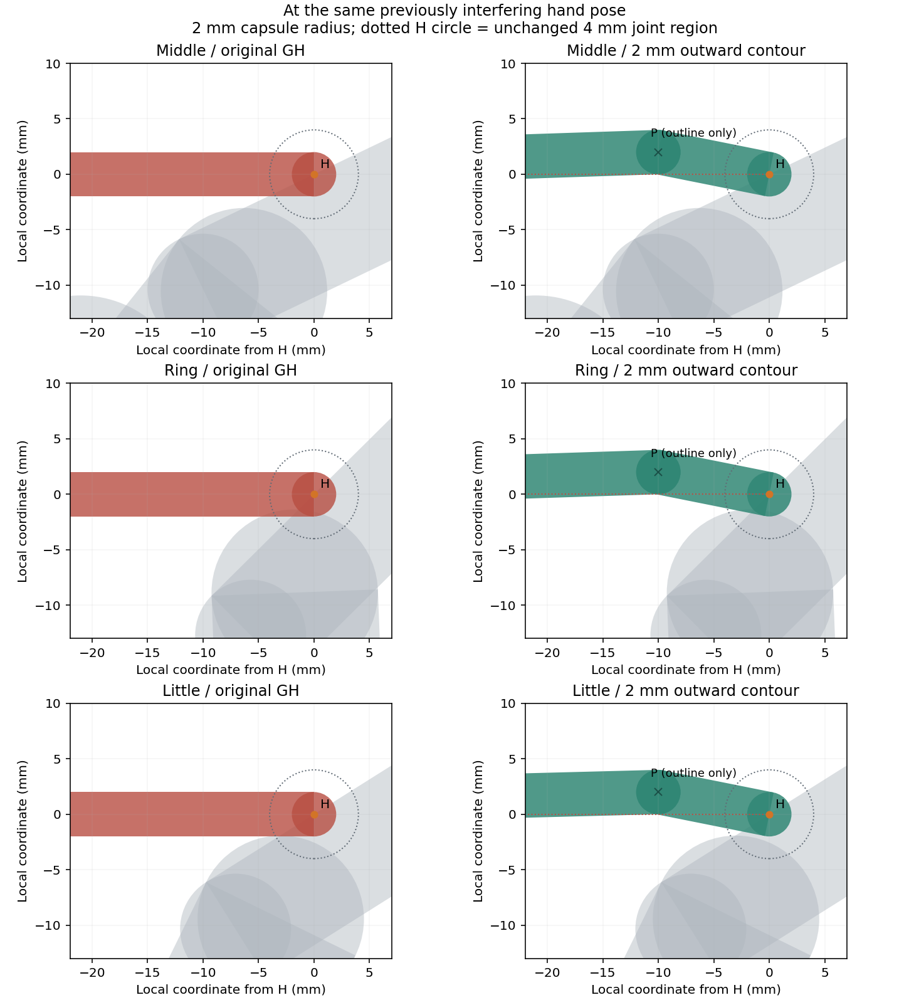
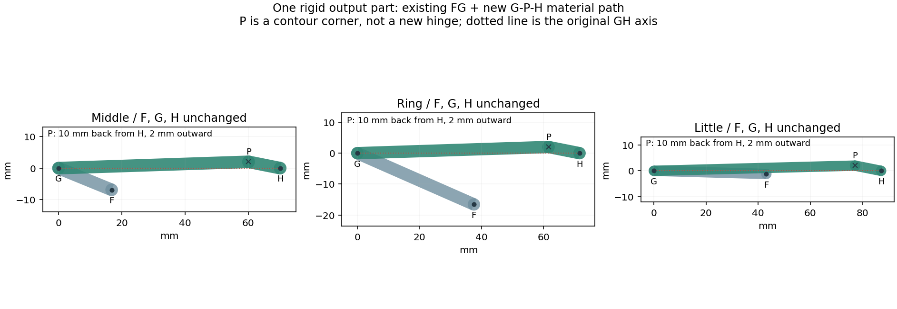
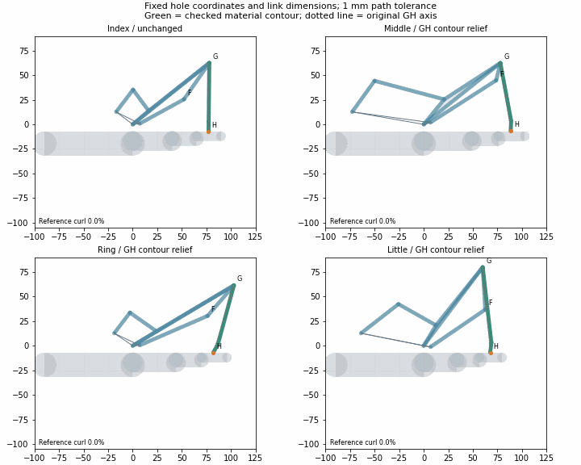

# 保留 1 mm 轨迹容差：GH 轮廓避让验证

按本轮用户要求，不再以 H/R4 全程严格重合为通过门槛；主要判据是参考轨迹误差 ≤ 1 mm，并消除所测手指姿态中的平面干涉。

**结果：四指通过这一轮采样判据。食指不改形；中指、无名指、小指仅调整 GH 实体轮廓。所有杆长、F/G/H 孔位、安装孔和手指测量尺寸保持不变。**

## 修改方式

在 GH 原方向上，从 H 向 G 回退 10 mm，再向远离手指的一侧偏移 2 mm，设置轮廓点 P。输出件的 GH 侧材料沿 G→P→H 连接；FG 侧保留。P 不是铰接，不增加自由度，也不是新的独立连杆。
材料路径按半径 2 mm 的胶囊段并集检查，包含拐角占用空间。H 处原有 4 mm 局部安装豁免保持原值，D 处原 12 mm 豁免保持不变。没有通过缩小杆半径、放大豁免区或改变手指尺寸来消除碰撞。
这是实体外形调整，继续使用原有 FG/GH/FH 长度表达；没有采用已取消的三孔坐标优化方案。

## 密集检查结果

每指 4,801 个电机位置；每个位置检查 11 档手指关节角：从原比例屈曲参考姿态逐步插值到上一轮已有拟合姿态。共 52,811 个姿态组合/指。拟合姿态先在电机角度上插值，因此同时检查了原 241 个姿态之间的运动位置。

| 手指 | 最大参考轨迹误差 mm | 修改前最小间隙 mm | 修改后最小间隙 mm | 当前最紧部位 |
|---|---:|---:|---:|---|
| 食指 | 0.2362 | 0.4090 | 0.4090 | GH_P_H/distal |
| 中指 | 0.9498 | -0.2670 | 0.1700 | L_ef/middle |
| 无名指 | 0.9204 | -0.3551 | 0.1001 | L_ef/middle |
| 小指 | 0.7082 | -0.0231 | 0.7500 | GH_P_H/middle |

负间隙表示该平面模型中的重叠。新轮廓在全部已测试姿态中均无负间隙，参考轨迹误差与原候选一致；这些插值姿态中的 H/R4 最大错位也未超过 1 mm。
中指和无名指的最紧部位已从 GH 转移到 EF / 中节手指，故继续加大 GH 偏出量不会增加整体最小间隙。当前分别约 0.17、0.10 mm，余量仍较小。食指原本无干涉，因此保留原轮廓。

## 轮廓候选比较

固定从 H 回退 10 mm，测试偏出 0、0.5、1、1.5、2、3 mm。下面均为整组 52,811 姿态的整体最小间隙：

| 手指 | 0 mm | 0.5 mm | 1 mm | 1.5 mm | 2 mm | 3 mm |
|---|---:|---:|---:|---:|---:|---:|
| 中指 | -0.2670 | -0.0891 | 0.0832 | 0.1700 | 0.1700 | 0.1700 |
| 无名指 | -0.3551 | -0.1626 | 0.0264 | 0.1001 | 0.1001 | 0.1001 |
| 小指 | -0.0231 | 0.1750 | 0.3708 | 0.5628 | 0.7500 | 0.8264 |

选 2 mm 作为三指统一的轮廓候选：相较 1 mm 有更好的 GH 局部余量，又无需扩大到 3 mm。没有重新搜索其他杆长。无名指沿用上一轮 DG=120 mm 的候选，未在本轮进一步加长。

## 验证范围与文件

结论仅覆盖上述平面参考/拟合插值姿态族，不代表任意自然手姿态。刚度、轴座、三维错层、相邻手指与机构内部自碰撞没有在本轮新增验证；这里给出的是轮廓候选，并非完整制造图。
本目录作为当前候选尺寸归档在 `wanwan`；旧优化器入口仍使用历史模型，未作为本轮轮廓的验证入口。源计算基线提交为 `eaa99da09862c05bcbfeea907cd4c48453f80f96`。所有冻结输入及计算代码随报告保存。
零偏出量回归检查确认新轮廓碰撞计算与原直线 GH 一致；刚体检查确认 P 相对 F/G/H 的距离在运动中保持不变，且未修改孔位。

- `selected/<finger>/result.json`：原尺寸与新增轮廓说明。
- `selected/<finger>/validation.json`：完整判据、偏出量对比及各档手指姿态结果。
- `selected/<finger>/clearance_sweeps.json.gz`：全部逐姿态间隙数据。
- `baseline/`：原 1 mm 候选及原关节拟合数据。

在本目录可复现：

```bash
export KINEMATIC_CHAIN_REPO=/home/jianai/kinematic_chain
python3 -B test_clearance.py
python3 -B check_clearance.py --finger middle --out /tmp/middle-outline-check
```







新候选使用显式 `rigid_G_P_H_outline` 类型及本报告的 `check_clearance.py` 验证；旧的三角形/L形杆验证入口会拒绝该类型，避免忽略新轮廓而输出旧模型结果。

## 当前尺寸入口

`current_dimensions.yaml` 包含四指杆长、起始孔位、电机角度范围和 GH 轮廓定义；`dimensions.csv` 可直接查看或导入表格。FG/GH/FH 是孔间几何尺寸，改形后的 G→P→H 材料路径长度不等于 GH 孔距。
