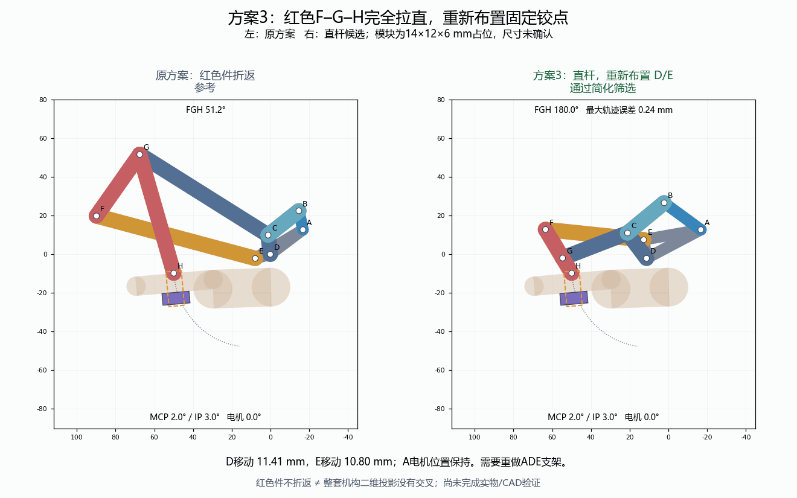

# 拇指禁止折返候选 v1：方案 3

本候选将红色刚体 **F–G–H 拉成直杆，G 位于 F 和 H 之间**，同时重新布置固定铰点 D、E。保留电机 A 的位置、原连杆连接关系和 GH 的佩戴朝向要求。振动单元位于远节指腹，通过绑带连接 H 附近。

这是通过运动学及简化间隙筛选的方案 3，**尚未生成对应的 STEP/CAD 加工模型**。原 `thumb_direct` 目录的 CAD 属于旧折返方案，不能与这里的新参数混用。



## 选用结果

| 项目 | 方案 3 |
|---|---:|
| 红色 FGH 夹角 | 180°，全程保持共线 |
| FG / GH / FH 孔中心距 | 17.219476 / 9.135494 / 26.354969 mm |
| D 相对原位置的位移 | 11.413702 mm |
| E 相对原位置的位移 | 10.804459 mm |
| 初始 MCP / IP | 2° / 3° |
| 末端 MCP / IP | 45.000169° / 59.999210° |
| 电机行程 | 58.567026° |
| H 目标轨迹最大误差 | 0.239536 mm |
| 最小模块/绑带投影间隙 | 2.199955 mm |
| 最小分层杆销/人体间隙 | 0.299849 mm，ADE 与近节手指 |
| 最终复核 | 5001 个姿态，全部本轮筛选项通过 |

全部孔距、初始世界坐标和专用参数见 [parameters_relayout.json](parameters_relayout.json)，检查项见 [relayout.json](relayout.json)。两节拇指长度仍为 30/40 mm，H 位于远节中点。

## 禁止折返如何实现

采用正长度和角度参数化：`G = H + GH * u(phi)`，`F = G + FG * u(phi + bend)`。方案 3 固定 `bend = 0`，由构造保证 F–G–H 共线，而不是仅用软惩罚逼近 180°。

取消旧 GF 朝向限制；初始 H→G 与原方案的方向差不超过 15°，全行程不超过 25°，并保留指背侧与指尖方向投影要求。闭环 BCD、EFG 的分支连续性和相切裕量单独检查，因此不会将直杆刚体本身误判为闭环奇异。

搜索与筛选参数见 [constraints.json](constraints.json)。禁止折返针对红色输出件本身，不代表整套机构的二维投影完全没有交叉。

## 三组实验

| 实验 | 搜索起点数 | 本轮结果 |
|---|---:|---|
| 1：直杆，A/D 固定，E 最多移动 5 mm | 15 | 未找到通过全部筛选的解；代表候选轨迹误差 9.53 mm，MCP 出现反向运动 |
| 2：夹角 150°～180°，相同安装点限制 | 18 | 未找到通过全部筛选的解；代表候选误差 9.51 mm，MCP 出现反向运动 |
| **3：直杆，A 固定，D/E 可重新布置** | **9** | **选用；5001 个姿态复核通过** |

方案 3 搜索允许 D 移动最多 25 mm、E 移动最多 50 mm，最终位移见上表。方案 1/2 未找到解不是无解证明。`straight.json`、`gentle.json` 和对应动图为失败实验，不能作为可用设计。

[三组对比动图](three_schemes.gif) · [完整实验报告](实验结果与说明.txt) · [独立方案3动图](relayout.gif)

## 佩戴与加工边界

模块暂按沿指长 × 横向宽 × 高 **14 × 12 × 6 mm** 占位，绑带暂按宽 8 mm、厚 1 mm；这些尺寸尚未由用户确认。侧视图中的橙色框是绕指绑带的投影示意，不是穿过手指的实体。

约 0.30 mm 的最小简化间隙不包含制造及佩戴误差。需要重做 ADE 支架，并对完整舵机、固定座、真实模块、绑带走线、紧固件及连续扫掠进行三维校核。当前结果没有验证绑带受力、人体舒适性或舵机负载。

## 复现

`reproduction/` 包含独立参考模型、优化/绘图脚本以及 42 个起点的搜索记录。参考版本与运行环境见 [provenance.json](provenance.json)。依赖为 Python、NumPy、SciPy、Matplotlib 和 Pillow；绘图默认使用 Windows 微软雅黑字体。

在 `reproduction/` 目录运行：

```shell
python thumb_no_return.py straight --trials 15
python thumb_no_return.py gentle --trials 18
python thumb_no_return.py relayout --trials 9
python render_thumb_no_return.py
```

前三条命令读取已保存的搜索记录，重新验证选中候选；提高 `--trials` 可继续搜索。输出写入被 Git 忽略的 `reproduction/generated/`。更多说明见 [使用说明](reproduction/使用说明.txt)。

**参数格式注意：**本实验的 `z` 是 13 参数格式，包含 D 的位置及红色件形状参数，与原项目 11 参数 `direct_synthesis` 不兼容，不能直接替换旧 CAD 构建脚本的参数文件。当前专用正向模型为 `reproduction/thumb_no_return.py`。
